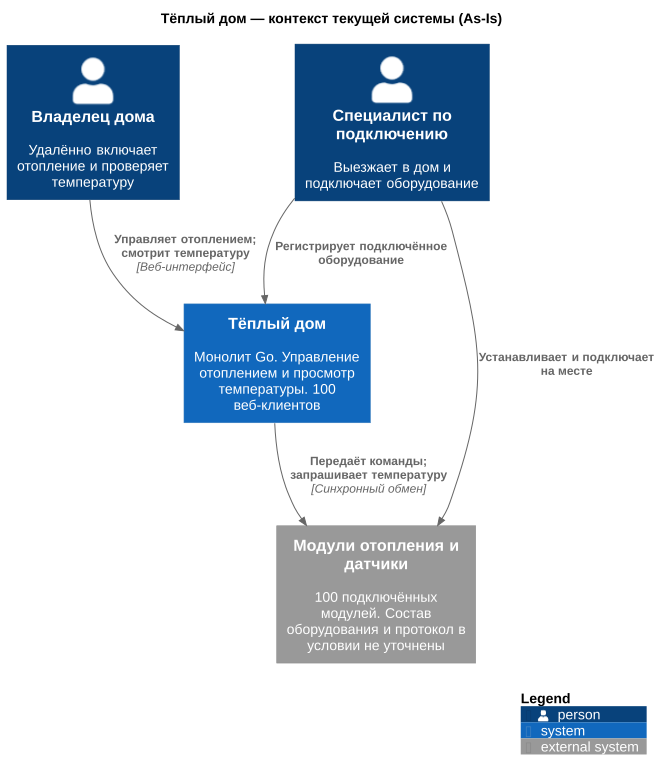
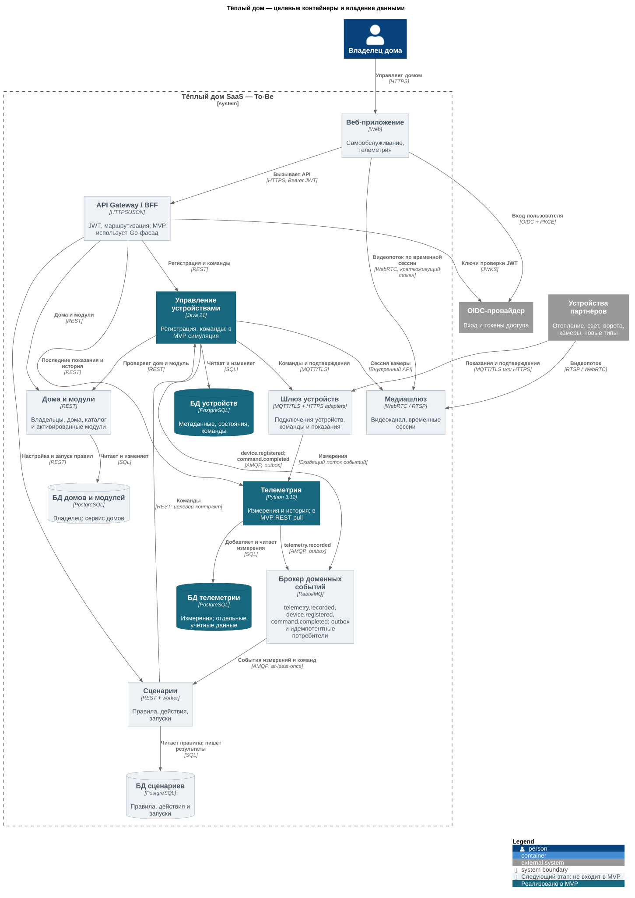
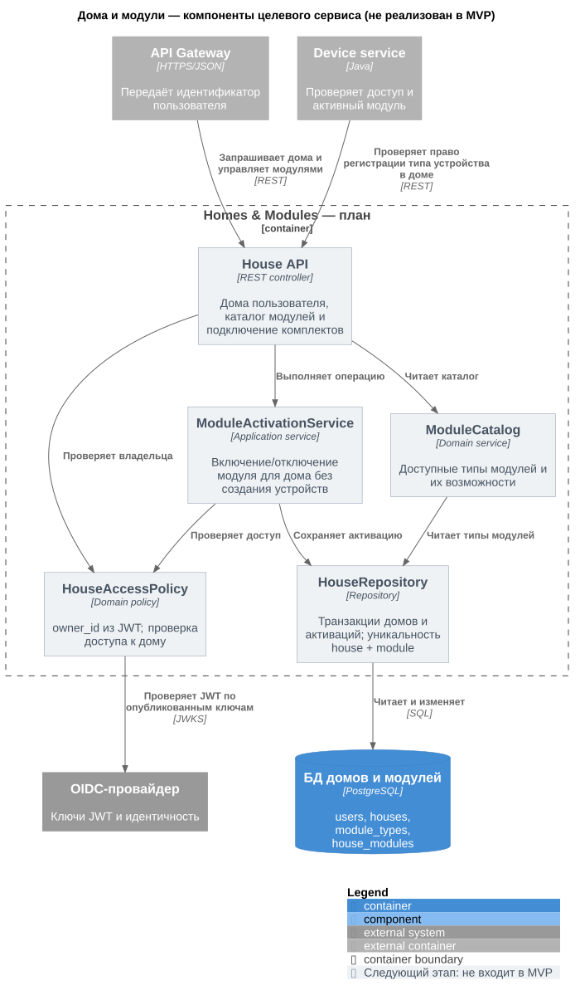
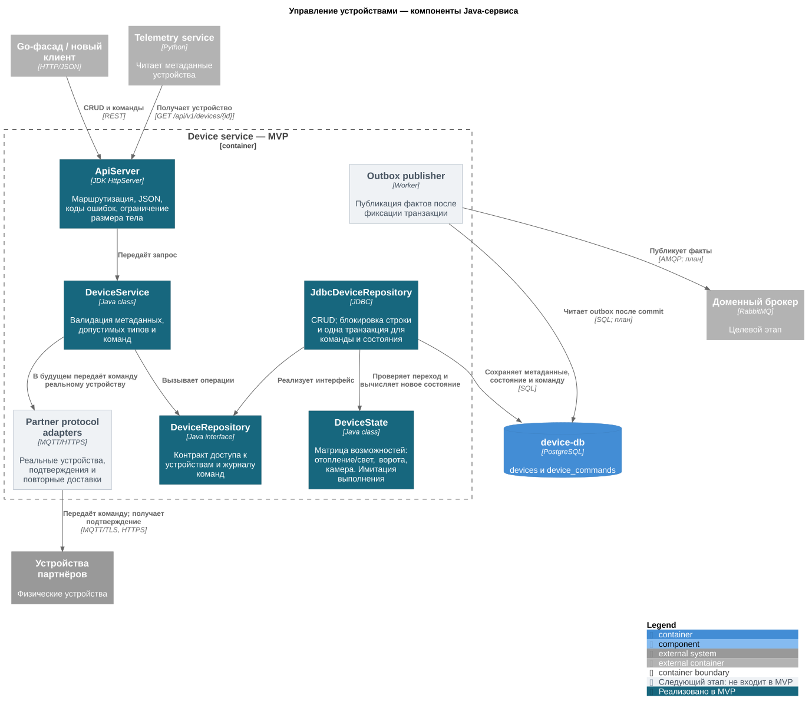
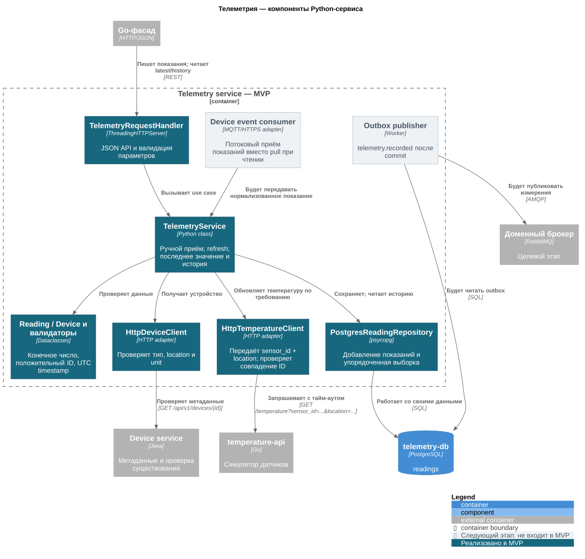
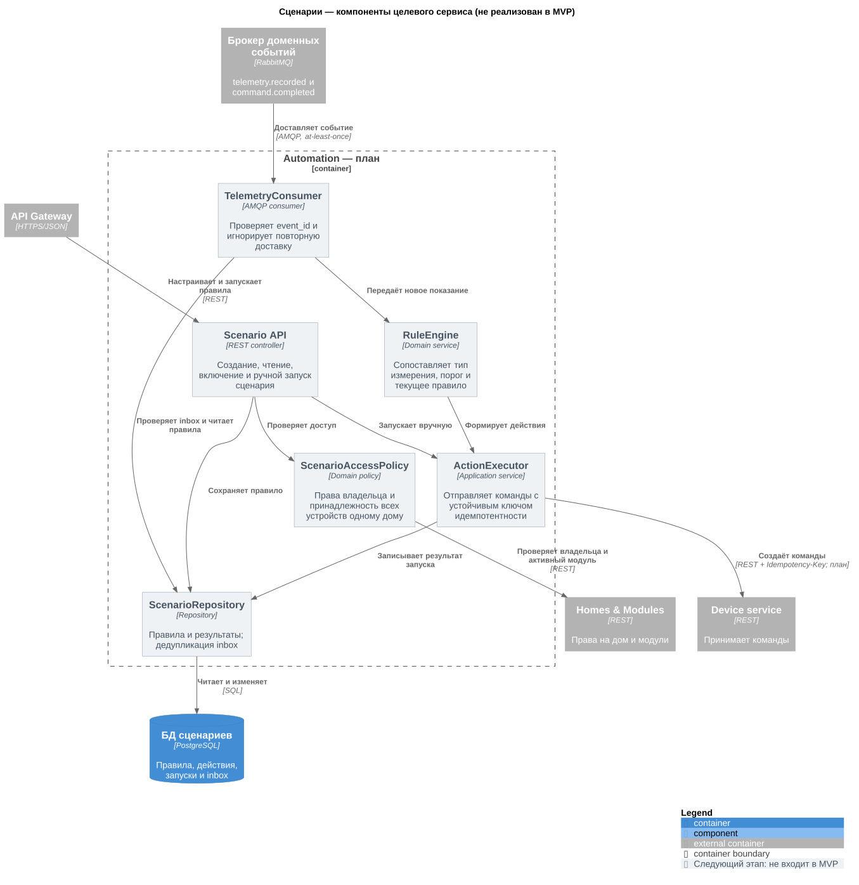
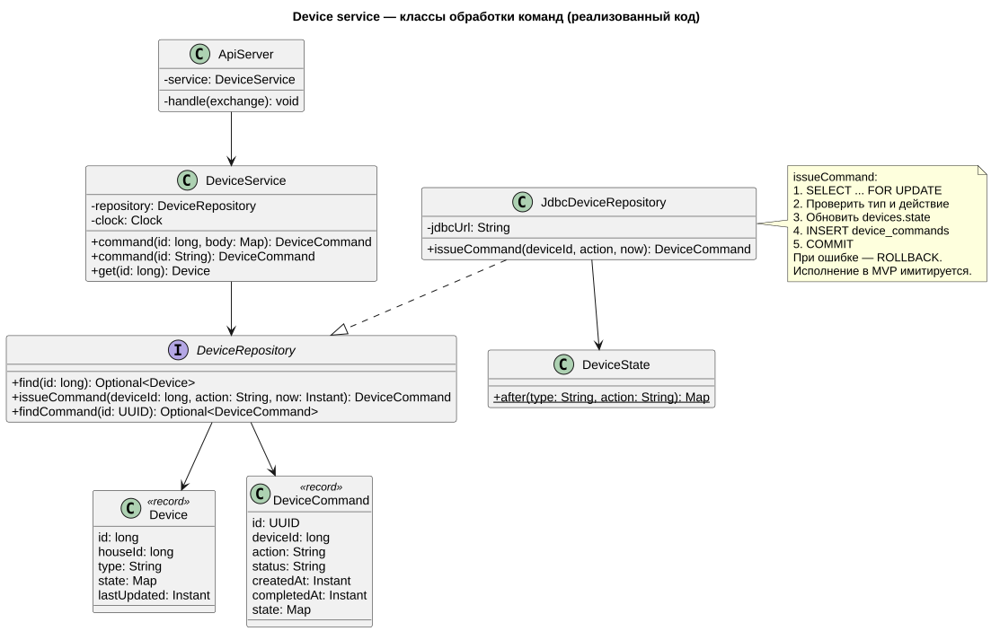
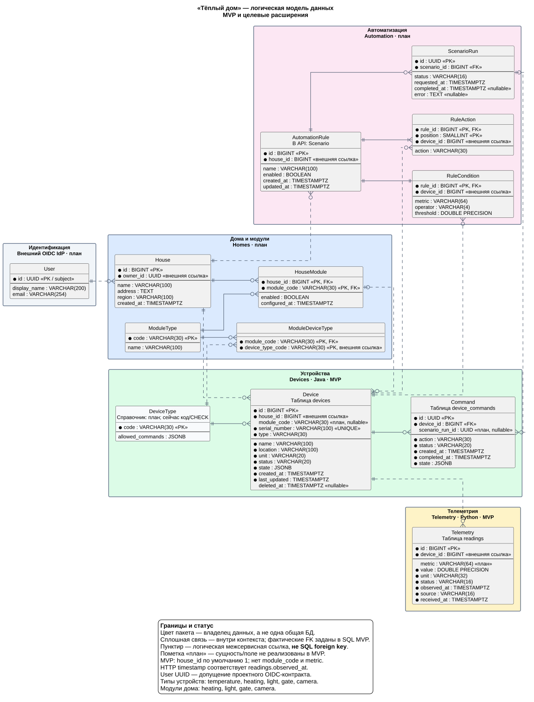

# Project_template: Тёплый дом

# Задание 1. Анализ и планирование

### 1. Описание функциональности монолитного приложения

**Управление отоплением.** 

- клиент включает и выключает отопление через веб-приложение
- монтаж и подключение модулей выполняет специалист компании
- самостоятельная регистрация и подключение партнёрского оборудования не предусмотрены

**Мониторинг температуры.** 

- сервер по запросу клиента синхронно получает показание от оборудования и возвращает его пользователю
- исходная установленная база: 100 веб-клиентов и 100 отопительных модулей
- код шаблона демонстрирует REST CRUD датчиков и чтение температуры, веб-интерфейс и управление физическим оборудованием отсутствуют

### 2. Анализ архитектуры монолитного приложения

| Аспект | Текущее состояние |
| --- | --- |
| Сервер | Go 1.22, HTTP-маршрутизация через Gin |
| Хранилище | PostgreSQL, таблица `sensors` |
| Доступ к данным | Обработчики обращаются к БД через pgx |
| Взаимодействия | Синхронные HTTP-запросы к `temperature-api` при чтении температурных датчиков |
| Измерения | Ответ обогащается свежим значением; история показаний не сохраняется |
| Поставка | Один серверный модуль, учебный запуск через Docker Compose |

### 3. Определение доменов и границы контекстов

| Контекст | Ответственность | За пределами границы |
| --- | --- | --- |
| Дома и модули | Дом, владелец, каталог и подключение модулей | Пароли, измерения, команды оборудованию |
| Устройства | Реестр, типы, состояние и команды оборудования | История измерений, автоматизация |
| Телеметрия | Приём измерений, последнее показание и история | Реестр устройств, управление домами |
| Автоматизация | Условия сценариев, действия и история запусков | Владение устройствами, сбор показаний |
| Идентификация | Вход и идентичность пользователя | Бизнес-сущности дома и оборудования |

Отопление, свет, ворота и камеры представлены типами устройств внутри одного контекста. Модуль — подключаемая возможность дома, устройство — конкретное оборудование.

### 4. Проблемы монолитного решения

- учёт датчиков и получение показаний находятся в одном приложении; изменение этой логики требует общего выпуска.
- внешний источник опрашивается для каждого температурного датчика, влияя на время ответа и доступность API.
- габлица `sensors` смешивает метаданные и последнее значение, не описывая дома, модули и историю.
- при росте числа устройств сбор показаний и операции с реестром могут требовать разного масштабирования.

### 5. Визуализация контекста системы — диаграмма С4



[Исходник PlantUML](schemas/context-as-is.puml).

# Задание 2. Проектирование микросервисной архитектуры

**Диаграмма контейнеров (Containers)**



[Исходник PlantUML](schemas/containers-to-be.puml).

**Диаграмма компонентов (Components)**



[Исходник PlantUML](schemas/components-homes.puml).



[Исходник PlantUML](schemas/components-devices.puml).



[Исходник PlantUML](schemas/components-telemetry.puml).



[Исходник PlantUML](schemas/components-automation.puml).

**Диаграмма кода (Code)**



[Исходник PlantUML](schemas/code-device-commands.puml).

# Задание 3. Разработка ER-диаграммы



[Исходник PlantUML](schemas/er.puml).

Диаграмма отражает целевую модель данных. В MVP реализована часть, связанная с устройствами, командами и показаниями.

# Задание 4. Создание и документирование API

### 1. Тип API

Для синхронного взаимодействия микросервисов выбран REST поверх HTTP с JSON: дома, устройства и сценарии представлены ресурсами, а формат совместим с исходным API. В целевой архитектуре события устройств и показаний передаются через RabbitMQ, чтобы автоматизация обрабатывала их независимо от отправителей. MQTT используется для обмена показаниями и командами с оборудованием. В MVP сервисы взаимодействуют по HTTP без брокера.

### 2. Документация API

| Спецификация | Назначение |
| --- | --- |
| [Device API](docs/api/devices.yaml) | Реестр устройств и имитация команд, реализован |
| [Telemetry API](docs/api/telemetry.yaml) | Показания и история, реализован |
| [Legacy/facade API](docs/api/legacy.yaml) | API Go-монолита и совместимого фасада, реализован |
| [Temperature API](docs/api/temperature.yaml) | Имитатор температуры, реализован |
| [Homes API — план](docs/api/homes-planned.yaml) | Дома и подключение модулей |
| [Automation API — план](docs/api/automation-planned.yaml) | Сценарии и запуски |
| [Devices events — план](docs/api/devices-events-planned.yaml) | События регистрации устройств и выполнения команд |
| [Telemetry events — план](docs/api/telemetry-events-planned.yaml) | События записи показаний |

# Задание 5. Работа с docker и docker-compose

### Подготовка окружения

Из корня репозитория перейдите в каталог приложений:

```bash
cd apps
```

Если `.env` ещё нет, скопируйте [шаблон](apps/.env.example):

```bash
cp .env.example .env
```

Имена БД и пользователей можно оставить из шаблона. Заполните `POSTGRES_PASSWORD`, а для MVP также `DEVICE_POSTGRES_PASSWORD` и `TELEMETRY_POSTGRES_PASSWORD`. Используйте в паролях латинские буквы, цифры и символы `-_.~`: строки подключения собираются без URL-кодирования. Compose автоматически читает `.env` из каталога `apps`.

### Запуск и проверка

Из `apps`:

```bash
docker compose up --build -d --wait
```

Запускаются PostgreSQL, Go-монолит в режиме `legacy` на порту 8080 и `temperature-api` на порту 8081. База создаётся через `POSTGRES_DB`; `smart_home/init.sql` создаёт таблицу и индексы при первой инициализации пустого тома.

Имитатор обслуживает `/temperature?location=...`. ID передаётся параметром `sensor_id`, например `/temperature?sensor_id=2`. Если помещение не указано, оно определяется по ID: `1` — Living Room, `2` — Bedroom, `3` — Kitchen, иначе Unknown. Если ID не передан, он определяется по той же таблице; для прочих помещений используется `0`.

Импортируйте [коллекцию Postman](apps/smarthome-api.postman_collection.json), выполните `Create Sensor`, затем несколько раз `Get All Sensors`. Значение температуры должно меняться при каждом вызове.

Остановка базового стенда: `docker compose down`.

# Задание 6. Разработка MVP

### Что нужно сделать

1. Созданы сервис управления устройствами на Java и сервис телеметрии на Python. Команды устройствам имитируются.
2. Go-монолит в режиме `services` сохраняет свои маршруты, передавая операции с устройствами в Device Service, а показания — в Telemetry Service. Телеметрия получает метаданные через Device API и собирает температуру у имитатора.

Данные из legacy-базы автоматически не переносятся в базы MVP.

Используйте тот же `.env`, заполнив все три пароля. Из каталога `apps`:

```bash
docker compose -f docker-compose.yml -f docker-compose.mvp.yml up --build -d --wait
```

| Компонент | Реализация | Порт |
| --- | --- | --- |
| Совместимый фасад | Go, `MIGRATION_MODE=services` | 8080 |
| Имитатор температуры | Go | 8081 |
| Устройства | Java 21, собственная PostgreSQL | 8082 |
| Телеметрия | Python 3.12, собственная PostgreSQL | 8083 |

Остановка MVP: `docker compose -f docker-compose.yml -f docker-compose.mvp.yml down`.
